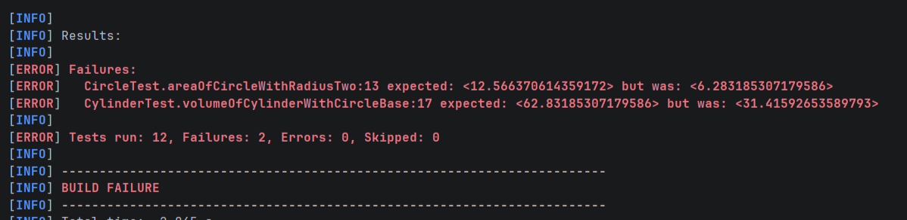
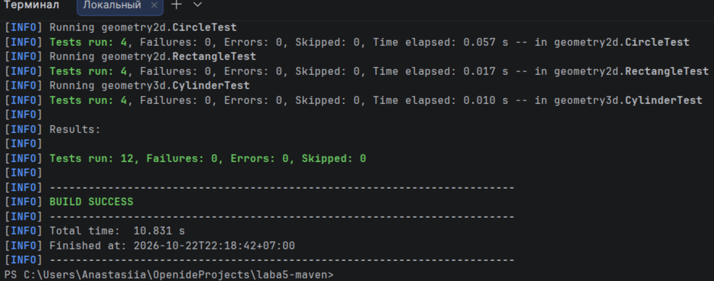

# Лабораторная работа №4. Сборка проекта с Maven и модульное тестирование с JUnit

**Автор:** Теплякова Анастасия Владимировна  
**Группа:** ФИТ-251

## Команды

- Запуск тестов: `.\mvnw.cmd test`
- Сборка JAR: `.\mvnw.cmd clean package`
- Запуск приложения: `java -jar target/laba5-1.0-SNAPSHOT.jar`

## Проверка обнаружения ошибки (Задание 5)

Для проверки работы тестов в метод `area()` класса `Circle` была намеренно внесена ошибка (убрано возведение радиуса в квадрат).

При запуске тестов Maven выдал ошибку:

После возврата правильной формулы все тесты снова проходят успешно:
